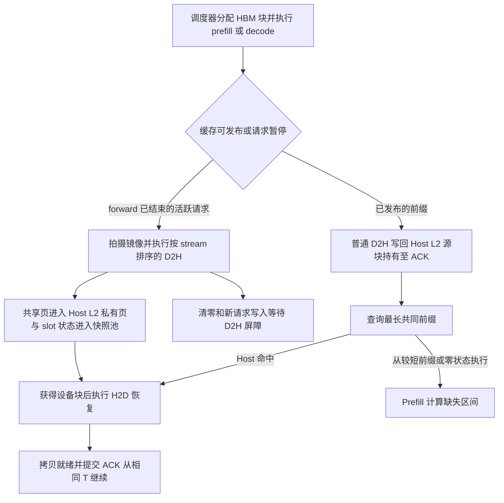

# 作业 3 实验报告｜TokenSpeed 在 Ascend 上的 HBM–Host 分层缓存与 Offloading

## 小组成员及主要贡献

小组成员为李浩然、邝代康和戴思颖。

| 本阶段工作 | 小组完成内容 |
| --- | --- |
| 运行环境与推理适配 | 构建当前版本的 TokenSpeed 调度器，校验 0.8B 和 4B 权重，将 Ascend GDN、卷积、KV 写入与 HCCL 接入正式服务路径。 |
| 缓存与正确性验证 | 打通分页 KV、GDN 状态和卷积窗口的卸载与恢复，核对 HBM 块复用、跨 rank ACK、多会话隔离、Host 淘汰与重复恢复。 |
| 容量与性能实验 | 建立固定设备预算下的高、低复用对照，记录 Host 容量、传输、重算及端到端延迟，并整理脚本与原始记录。 |

实验在 TokenSpeed 仓库的 `hw3-ascend-offloading` 分支开展，基线提交为 `f042332d`。实测日期为 2026 年 11 月 18 日，分工表按本阶段小组工作记录。

## 1. 实验目标与完成范围

本实验在作业一的 Ascend 单芯片计算适配和作业二的双芯片张量并行基础上，将 Qwen3.5 的文本推理接入 TokenSpeed 正式调度器。运行时在 HBM 和 Host 内存之间移动分页 Attention KV、Gated DeltaNet（GDN）递归状态和因果卷积状态，调度器可回收设备块并在需要时恢复请求。容量管理沿用 TokenSpeed 的 LCM 块池、Host L2 前缀缓存和请求快照机制。

实测使用 BF16 文本模型和 eager 执行，涵盖 Qwen3.5-0.8B 的 TP=1、TP=2，以及 Qwen3.5-4B 的 TP=2。正确性实验覆盖活跃会话暂停后续推、交替执行、预算淘汰与未命中、反复恢复、双 rank 确认。性能实验固定 HBM 缓存预算，比较关闭 Offloading 和开启不同 Host 预算时的容量、搬运和推理效果。 [作业三复现说明](README.md) · [实测结果汇总](../../hw3_results/summary.json)

## 2. 环境、权重与启动方式

### 2.1 实测环境

| 项目 | 实测值 |
| --- | --- |
| CPU / OS | aarch64 / openEuler 24.03 LTS SP3，Linux 5.10.0，glibc 2.38 |
| NPU 与 CANN | Ascend 910，单芯片标称 HBM 65,536 MB，CANN 9.0.0，驱动及 `npu-smi` 25.5.2 |
| 芯片选择 | 主要单芯片用例使用物理 chip 1，双芯片用例使用 6、7，8 块并发压力用例使用 chip 0，补充 logprob 用例使用 chip 5 |
| Python 环境 | Python 3.11.16，`.venv-hw3` 继承 `/opt/miniconda3/envs/aics` |
| 执行配置 | BF16 文本推理，eager，贪心生成，固定输出长度，分页粒度和 prefill chunk 均为 128 token |
| 内核与通信 | GDN 内部 chunk 为 64，递归状态以 FP32 保存。TP=2 使用 HCCL，Host 搬运使用 `direct` DMA |
| 调度配置 | 最多设定 2 个请求槽，关闭 overlap 调度，使用本地融合服务，即同一服务实例处理 prefill 和 decode |

| Python 依赖 | 版本 |
| --- | --- |
| torch / torch_npu | 2.9.0+cpu / 2.9.0 |
| transformers / safetensors | 5.17.0 / 0.8.0 |
| triton-ascend / tokenspeed-kernel-npu | 3.2.1 / 0.1.0 |
| tokenizers / huggingface_hub / numpy | 0.23.2 / 1.32.0 / 2.4.6 |
| tokenspeed-scheduler | 0.1.35，从当前源码构建 |

### 2.2 固定权重与模型配置

| 模型 | 本地目录 | Hugging Face revision |
| --- | --- | --- |
| Qwen3.5-0.8B | `$HOME/models/Qwen3.5-0.8B` | `2fc06364715b967f1860aea9cf38778875588b17` |
| Qwen3.5-4B | `$HOME/models/Qwen3.5-4B` | `851bf6e806efd8d0a36b00ddf55e13ccb7b8cd0a` |

模型目录包含对应 revision 的配置和 tokenizer。权重分片从 ModelScope 下载，按 Hugging Face 对应 revision 的 SHA256 校验。复核得到以下散列。

| 模型与分片 | SHA256 |
| --- | --- |
| 0.8B，1/1 | `04b1c301231dd422b8860db31311ab2721511346a32cb1e079c4c4e5f1fe4696` |
| 4B，1/2 | `26a93f066e1916adb13453dae5a0c707c0fbc71299ed98779571a907b8e74c61` |
| 4B，2/2 | `cb544bd9bfae93dc59b0f22b292f5933573854a7f9b97835c67060d7d910e188` |

两款模型由正式 `Engine` 加载文本权重，测试直接提交固定 token ID 序列，生成采用贪心解码，并按设定长度终止。 [0.8B 权重加载日志](../../hw3_results/logs/0.8B-tp2-reference.log) · [4B 权重加载日志](../../hw3_results/logs/4B-tp2-reference.log)

### 2.3 复现命令

在已有实验环境中从仓库根目录执行。`hw3_repro` 保存本次复现的输出。

```bash
source .venv-hw3/bin/activate
source /usr/local/Ascend/cann-9.0.0/set_env.sh
export PYTHONPATH="$PWD/python:$PWD/tokenspeed-kernel/python:$PWD/tokenspeed-kernel-npu/python:$PYTHONPATH"
export TOKENSPEED_HOST_CACHE_TRACE=1
mkdir -p hw3_repro/logs

OPENSSL_ROOT_DIR=/opt/miniconda3/envs/aics CMAKE_BUILD_PARALLEL_LEVEL=6 \
  python -m pip install --no-deps -e ./tokenspeed-scheduler

run_hw3() {
  local hw3_key="$1" hw3_model="$2"
  shift 2
  python -B test/hw3/offloading.py "$HOME/models/$hw3_model" "$@" \
    --output "hw3_repro/$hw3_key.json" > "hw3_repro/logs/$hw3_key.log" 2>&1
}

export ASCEND_RT_VISIBLE_DEVICES=6,7
run_hw3 0.8B-tp2-reference Qwen3.5-0.8B --case reference --tp 2 \
  --device-tokens 12288 --host-ratio 0 --snapshot-ratio 0 --steps 16 --port 31943
run_hw3 0.8B-tp2-resume Qwen3.5-0.8B --case resume --tp 2 \
  --device-tokens 12288 --host-ratio 2 --snapshot-ratio 1 \
  --force-retraction-interval 3 --steps 16 --port 31943
run_hw3 4B-tp2-reference Qwen3.5-4B --case reference --tp 2 \
  --device-tokens 16384 --host-ratio 0 --snapshot-ratio 0 --steps 12 --port 31944
run_hw3 4B-tp2-resume Qwen3.5-4B --case resume --tp 2 \
  --device-tokens 16384 --host-ratio 2 --snapshot-ratio 1 \
  --force-retraction-interval 3 --steps 12 --port 31944

export ASCEND_RT_VISIBLE_DEVICES=1
run_hw3 0.8B-tp1-reference Qwen3.5-0.8B --case reference --tp 1 \
  --device-tokens 12288 --host-ratio 0 --snapshot-ratio 0 --steps 16 --port 31942
run_hw3 0.8B-tp1-resume Qwen3.5-0.8B --case resume --tp 1 \
  --device-tokens 12288 --host-ratio 2 --snapshot-ratio 1 \
  --force-retraction-interval 3 --steps 16 --port 31942

for hw3_case in high low; do
  for hw3_budget in off small large larger; do
    case "$hw3_budget" in
      off) hw3_host_ratio=0; hw3_snapshot_ratio=0 ;;
      small) hw3_host_ratio=0.5; hw3_snapshot_ratio=1 ;;
      large) hw3_host_ratio=2; hw3_snapshot_ratio=1 ;;
      larger) hw3_host_ratio=6; hw3_snapshot_ratio=1 ;;
    esac
    run_hw3 "0.8B-tp1-$hw3_case-$hw3_budget" Qwen3.5-0.8B --case "$hw3_case" --tp 1 \
      --device-tokens 12288 --host-ratio "$hw3_host_ratio" --snapshot-ratio "$hw3_snapshot_ratio" \
      --prompt-tokens 260 --steps 4 --requests 12 --locality 4 --port 31942
  done
done

export ASCEND_RT_VISIBLE_DEVICES=0
run_hw3 0.8B-tp1-pressure-off Qwen3.5-0.8B --case resume --tp 1 \
  --device-tokens 8192 --host-ratio 0 --snapshot-ratio 0 --steps 20 --port 31945
run_hw3 0.8B-tp1-pressure-on Qwen3.5-0.8B --case resume --tp 1 \
  --device-tokens 8192 --host-ratio 6 --snapshot-ratio 1 --steps 20 --port 31945

python -B test/hw3/summarize.py --results hw3_repro --logs hw3_repro/logs \
  --output hw3_repro/summary.json
```

采样分数对照可在单芯片上按 `reference` 和 `resume` 配置增加 `--logprobs --steps 12`。测试入口的参数和具体请求生成见脚本。 [实验入口](offloading.py) · [汇总脚本](summarize.py)

## 3. 分层缓存设计与 Ascend 适配

### 3.1 模型结构与持久状态

| 文本模型 | 总层数 | Full Attention / GDN 层 | Hidden size | GQA Q / KV heads | GDN K / V heads | 维度 |
| --- | ---: | ---: | ---: | --- | --- | --- |
| 0.8B | 24 | 6 / 18 | 1024 | 8 / 2 | 16 / 16 | GQA head dim 256，GDN K=V=128，卷积宽度 4 |
| 4B | 32 | 8 / 24 | 2560 | 16 / 4 | 16 / 32 | GQA head dim 256，GDN K=V=128，卷积宽度 4 |

以 `T` 表示本请求已完成计算的 token 数。状态在消费 `[0,T)` 后形成，恢复后的第一步从同一上下文边界继续。下表中的 head 数与通道数均指当前 rank 的本地分片，TP=2 下 4B 的 GDN 将本地 8 个 Q/K heads 按组展开以匹配 16 个 V heads。

| 状态 | 保存粒度与类型 | 与 `T` 的关系 | 恢复方式 |
| --- | --- | --- | --- |
| Attention K/V | 每层每 rank 的 K 和 V 页，单个字段为 `[128, H_kv, 256]`，BF16 | 完整页和有效尾页共同覆盖 `[0,T)`，尾页按实际边界标识 | H2D 填充本次分配的页，Attention 按新的块表读取 |
| GDN 递归状态 | 每线性层一个 K-last `[H_v, V, K]`，FP32 | 压缩了 `[0,T)` 的递归历史，一个状态块对应一个 checkpoint | 前缀命中时在输入 slot 0 放入只读 checkpoint，活跃请求恢复时为下一步计算重建可写工作槽 |
| 因果卷积状态 | 每线性层 `[C, W−1]`，BF16，本实验保存最近 3 个原始投影输入 | 这 3 个位置和 GDN 对应同一 `T`，短序列的左侧按零状态处理 | 恢复历史窗口，进入 Ascend 短卷积算子前补齐宽度 4 的接口，更新后写回最近 3 个原始输入 |

GDN 的状态组用 slot 0 表示输入 checkpoint、slot 1 表示输出。活跃 decode 使用本请求的可写块继续更新。发布给前缀缓存的 checkpoint 通过只读引用共享，其他会话各自分配输出块。Attention KV 按 token 页增长，GDN 与卷积保存同一边界的聚合状态。 [Qwen3.5 缓存布局](../../python/tokenspeed/runtime/layers/attention/kv_cache/recipes/qwen35.py) · [Ascend 卷积实现](../../tokenspeed-kernel-npu/python/tokenspeed_kernel_npu/ops/gdn.py)

### 3.2 缓存标识、所有权与数据搬运

TokenSpeed 用 LCM 父块管理固定字节容量，每个父块绑定一个缓存组，组布局决定其中容纳的子页数。实测布局中，full attention 组每父块装 8 个页，每个线性状态组每父块装 1 个子块。C++ 调度器持有各请求的块表及引用。发布的 L2 条目按缓存组、前缀内容哈希和页偏移索引，非整页边界以尾页哈希关联精确的 `T`。Host L2 和请求快照池都使用 rank 本地的 pinned Host 内存。



1. **普通写回。** 已发布的数据通过 `WriteBackOp` 搬入 Host L2。传输票据保留设备源块引用，直到对应 `WriteBackDone` 使 Host 条目可被查找、设备源块可被回收。
2. **活跃请求暂停。** 调度器选中已完成本轮 forward 的请求，在其已计算位置 `T` 拍镜像。已发布或可共享的块进入 L2，余下私有页和运行时 slot 状态进入快照池。镜像引用保护相应 L2 块直到恢复完成。
3. **设备块回收。** retraction 可以在同一个调度计划中把源页重新授予其他请求。执行线程先提交 D2H，在 forward stream 上等待该批拷贝的完成事件，再执行授予后的清零和模型写入。调度器的授权顺序和设备上的写入顺序共同保护源数据。
4. **按需恢复。** `RestoreOp` 把镜像写入本次分配的设备页并导回 slot 状态。运行时汇合各 rank 的 `RestoreDone`，调度器收到共同 ACK 后从镜像的 `T` 继续。普通 Host 前缀的 `LoadBackOp` 使用层就绪事件保护模型读取。

拷贝走已有的设备 stream 与 DMA 执行路径，Host 按原始字节保存 BF16 KV、BF16 卷积与 FP32 GDN 状态。 [调度器设计](../../docs/design/scheduler.md) · [Device 执行路径](../../python/tokenspeed/runtime/execution/device.py) · [Host 执行器](../../python/tokenspeed/runtime/cache/l2/executor.py)

### 3.3 容量、淘汰和未命中

- **预算。** `--kvstore-ratio` 按设备 LCM 父块数计算 Host L2 容量，`--kvstore-size` 可指定 Host L2 的绝对大小。请求快照池有独立的 `--retraction-snapshot-ratio` 或 `--retraction-snapshot-host-gb`，并通过 `--retraction-snapshot-max-requests` 控制快照槽数。各 rank 按自己的块布局分配 Host 内存。
- **淘汰。** L2 先使用空闲容量，再找同组可回收条目，必要时回收其他组的整个父块。可淘汰条目中，策略优先保留曾被请求复用、访问时间较近的条目。正在复制或者由活跃请求、挂起镜像引用的块受 pin 保护。私有快照随持有请求的恢复或结束释放。
- **未命中与重算。** 前缀复用取能够同时覆盖 KV、GDN 和卷积的最长 `T`。期望位置缺少其中一类状态时，查找更短的共同 checkpoint，再计算 `[T,N)`，其中 `N` 是本次 prompt 长度。完全未命中时从 `T=0` 做 Prefill。活跃请求镜像保存了恢复所需的状态，本实验的快照用例按原位置直接续推。调度器在镜像不足以承接候选请求且容量仍受阻时可按现有规则向客户端报告中止。

共享的是内容匹配且已经发布的数据，写入块和私有镜像各自绑定请求。模型版本和配置在本次同一服务实例内固定。 [缓存概念](../../docs/design/cache-concepts.md) · [Host 分配与淘汰源码](../../tokenspeed-scheduler/csrc/cache/coordinator/cache_coordinator.cpp) · [快照池容量计算](../../python/tokenspeed/runtime/cache/l2/sizing.py)

### 3.4 适配与调试记录

| 障碍 | 处理方式 | 验证 |
| --- | --- | --- |
| 单独的 eager 模型入口使用请求级缓存 | 让 Ascend GDN 和卷积使用共享分页状态接口，读取输入状态槽、写入调度器指定的工作槽 | 真权重模型经正式服务完成 prefill、逐 token decode 与恢复 |
| GPU 专用 Triton/Gluon/PDL 路径在 Ascend 的启动或前向阶段被触发 | 使用通过项目验证的 Triton-Ascend 3.2.1，按平台装载内核，接入 Ascend 的 KV scatter、归一化和输出门控 | 仓库工具链验证通过，两种模型正式服务前向完成 |
| 双芯片词表汇集受 PyTorch 集合通信 API 版本影响 | NPU 走已有 HCCL 集合通信，适配 PyTorch 2.9 的 gather 和 reduce-scatter API | 0.8B 和 4B 的 TP=2 生成和恢复均完成 |
| 默认统计难以回答块是否真实复用 | 增加缓存父块、快照槽、Host 命中和淘汰统计，记录逐 rank 拷贝字节、事件耗时与设备/Host 块 ID | 原始日志可追踪同一请求的操作 ID、`T` 和恢复后的输出 |

相关实现集中在共享缓存、Ascend 算子和设备通信路径。 [Ascend GDN 扫描](../../tokenspeed-kernel/python/tokenspeed_kernel/ops/attention/gdn/ascend.py) · [HCCL 适配](../../python/tokenspeed/runtime/distributed/comm_backend/hccl.py) · [调度器统计输出](../../python/tokenspeed/runtime/engine/event_loop.py)

## 4. 分层正确性验证

### 4.1 参考实现与判据

端到端的参考执行使用同一个 TokenSpeed 服务、同一模型权重、相同 TP 和 BF16 精度，关闭 Host L2 与请求快照。测试的 A 和 B 使用相同的前 130 个输入 token 和各自的不同尾部，输入均为 260 token。参考用例顺序执行 A/B。恢复用例在 A 输出第一个 token 后加入 B，并用调试参数触发 retraction。按请求比较完整的输出 token 序列，同时核对保存及恢复的 `T`、两 rank 的完成事件和资源生命周期。

| 对象 | 判据 |
| --- | --- |
| Host DMA | BF16 数据及带非零地址偏移的页范围经 D2H/H2D 往返后逐字节一致 |
| Ascend 分页 GDN | BF16 prefill/decode 输出采用 `atol=2e-3, rtol=2e-2`，FP32 状态采用 `atol=3e-4, rtol=3e-3`。读状态块和保留空槽须保持原值 |
| Ascend 分页卷积 | 恢复窗口与参考逐元素相等，更新只写入指定目标块 |
| 完整模型与会话隔离 | A/B 各自在每一步的贪心 token ID 与参考完全相同 |
| 恢复安全性 | 同一操作对应相同 `T`，TP=2 的两个 rank 都报告完成。退出前 Host pin 和挂起请求数须回到 0 |

判据的实现和采样分数可分别查阅分页测试与运行结果。 [DMA 测试](../../tokenspeed-kernel/test/ops/test_host_cache_transfer.py) · [分页 GDN 和卷积测试](../../tokenspeed-kernel/test/ascend/test_paged_gdn.py) · [logprob 对照](../../hw3_results/0.8B-logprobs-resume.json)

### 4.2 回归测试

| 测试组 | 通过 | 跳过 | 覆盖 |
| --- | ---: | ---: | --- |
| C++ 调度器的 Python 回归 | 66 | 0 | KV 管理、双槽状态、retraction 镜像 |
| 运行时回归 | 62 | 6 | NPU Attention 后端、Host 执行器、镜像执行器、恢复驱动 |
| 内核回归 | 60 | 3 | Ascend 分页 GDN/卷积、Host 缓存传输与不连续地址范围 |
| 合计 | 188 | 9 | 跳过项依赖测试设备或执行后端 |

```bash
export ASCEND_RT_VISIBLE_DEVICES=5
export TOKENSPEED_HOST_CACHE_TRACE=0
python -B -m pytest -q tokenspeed-scheduler/python/tests/test_retraction_image.py \
  tokenspeed-scheduler/python/tests/test_state_two_slots.py \
  tokenspeed-scheduler/python/tests/test_kv_cache.py
python -B -m pytest -q test/runtime/layers/test_npu_attention_backend.py \
  test/runtime/test_host_executor.py test/runtime/test_retraction_image_executor.py \
  test/runtime/test_retraction_restore_driver.py
python -B -m pytest -q tokenspeed-kernel/test/ascend/test_paged_gdn.py \
  tokenspeed-kernel/test/ops/test_host_cache_transfer.py
```

[调度器测试日志](../../hw3_results/logs/scheduler-tests.log) · [运行时测试日志](../../hw3_results/logs/runtime-tests.log) · [内核测试日志](../../hw3_results/logs/kernels-final.log)

### 4.3 完整模型、双卡一致性和资源回收

| 模型及并行 | 输出比对 | 恢复次数 / 全部 rank 确认 | H2D 中位 ms | 结束时 Host pin / 快照池空闲父块 |
| --- | --- | ---: | ---: | --- |
| 0.8B TP=1 | A、B 各 16 token，全部一致 | 14 / 14 | 4.46 | 0 / 12 |
| 0.8B TP=2 | A、B 各 16 token，全部一致 | 14 / 14 | 3.63 | 每 rank 0 / 12 |
| 4B TP=2 | A、B 各 12 token，全部一致 | 11 / 11 | 4.10 | 每 rank 0 / 16 |

TP=2 的 H2D 中位值取每次恢复的两 rank 设备事件耗时较大者，再对这些操作求中位。0.8B 的操作 12 在 rank 0 和 rank 1 均确认完成，两边各恢复 20,324,352 字节。4B 的操作 7 两边各恢复 27,852,800 字节。各次恢复记录的 `T` 都在相同请求的暂停记录中出现。三个用例结束时挂起请求数均为 0，快照池空闲父块回到初始数量。另一次 0.8B TP=1 对照中，A/B 各 12 个所选 token 的 logprob 最大绝对差为 0。 [0.8B 双卡日志](../../hw3_results/logs/0.8B-tp2-resume.log) · [4B 双卡日志](../../hw3_results/logs/4B-tp2-resume.log) · [结果汇总](../../hw3_results/summary.json)

0.8B 和 4B 的 TP=2 用例双 rank 合计分配的 HBM 缓存 arena 分别为 156 MiB 和 544 MiB，各自与同模型参考运行一致。恢复用例计时区间的 D2H/H2D 页数据总量分别为 420.43/300.49 MiB 和 960.25/584.38 MiB。D2H 总量包含普通 L2 写回和 retraction 写回。 [逐操作统计](../../hw3_results/summary.json)

### 4.4 HBM 块复用与 Host 淘汰证据

0.8B 单芯片用例记录了 A 暂停、B 实际复用旧设备父块、A 恢复的完整过程。该模型的线性状态组每父块只有一个子块，状态页号可用于核对这些父块。

| 原始日志行 | 事件与观察 |
| ---: | --- |
| 129 | A 的已计算位置为 `T=263`，调度器暂停 A 并建立镜像 |
| 134 | D2H 操作 5 完成，A 的状态组源块包含设备父块 2 和 4，拷贝 21,110,784 字节 |
| 136–137 | A 的恢复计划记录相同的 `T=263`。随后可见 B 的 prefill 计划将父块 2 和 4 分配给其线性状态组 |
| 142 | H2D 操作 7 完成，从 Host 将 A 的镜像写入恢复块，传输 21,110,784 字节 |

A 与 B 的输出各自通过参考比对。在高复用的 0.5 倍 L2 预算中，Host 占用峰值达到可用的 6 个父块，发生 120 次条目淘汰，12 次请求均从冷前缀完成 prefill，并给出与关闭卸载相同的输出。反复暂停与结束后的快照池统计见上一节。 [A/B 块级日志](../../hw3_results/logs/0.8B-tp1-resume.log) · [小预算淘汰日志](../../hw3_results/logs/0.8B-tp1-high-small.log)

## 5. 容量与性能基线

### 5.1 测量方法

0.8B TP=1 的矩阵在同一物理芯片上运行。各配置都使用 12 个可用的设备 LCM 父块和相同的 156 MiB HBM 缓存 arena（包含空块），每组顺序提交 12 个请求，输入为 260 token，每请求生成 4 token。高复用先发布 4 组 256 token 的 checkpoint，再使计时请求轮流追加 4 token。低复用使用 12 个不同前缀。高复用的四档采用相同预热方式。关闭时 L2、快照池都设为 0。开启时快照池保持 12 个父块，改变 L2 的 6、24、72 个父块预算。性能矩阵采用默认容量调度，强制 retraction 用于第 4 节的功能验证。

| 指标 | 统计口径 |
| --- | --- |
| HBM 缓存 arena | 从缓存预分配日志读取字节数，含空块，以 MiB 表示 |
| 设备已用与可用块 | 取调度计划中的已用峰值和可分配最小值。可分配包含空闲块及可直接回收的缓存父块 |
| Host 占用 | 记录 L2、快照和 slot arena 的分配量，L2 峰值取计时区间的已占用父块数乘以父块大小 |
| D2H/H2D 流量 | 汇总计时标记之后已完成的页数据传输，按实际字段字节计数，多 rank 按各自传输量求和 |
| 传输耗时 | 在 NPU 传输 stream 上记录开始和完成事件，分别统计写回、前缀载入和快照恢复 |
| TTFT 与吞吐 | TTFT 从请求提交到收到第一个生成 token，含调度、prefill、搬运及必要的重算。吞吐为计时区间生成 token 总数除以墙钟时间 |
| Prefill 工作量 | 按计时请求的调度块累计实际计算的前缀及后缀 token。Host 命中计实际发起 L2 载入的请求 |

每档是一轮 12 请求样本，表中的 TTFT 使用中位数。计时在模型加载、脚本预热与相应的 checkpoint 预置完成后开始。Host 资源关闭时按 0 记录 Host 命中、未命中、淘汰和搬运量。缓存 arena 是本实验的 HBM 占用口径，整个进程还持有权重及其他张量。页回收由块表调度和实际复用验证。 [测量实现](offloading.py) · [统计实现](summarize.py)

### 5.2 开关及 Host 预算对照

下表的 8 组均完成 12/12 个请求。开启各组的输出 token 序列均与相同访问模式的关闭组一致。

| 复用 | L2 比例 / 父块数 | Host 命中 / 未命中 / 淘汰 | 实际 Prefill token | TTFT 中位 ms | 输出 token/s |
| --- | --- | ---: | ---: | ---: | ---: |
| 高 | 关闭 / 0 | 0 / 0 / 0 | 3120 | 310.68 | 7.63 |
| 高 | 0.5 / 6 | 0 / 12 / 120 | 3120 | 316.20 | 7.48 |
| 高 | 2 / 24 | 0 / 12 / 70 | 3120 | 300.67 | 7.74 |
| 高 | 6 / 72 | 12 / 0 / 0 | 48 | 106.00 | 12.22 |
| 低 | 关闭 / 0 | 0 / 0 / 0 | 3120 | 337.30 | 6.86 |
| 低 | 0.5 / 6 | 0 / 12 / 114 | 3120 | 294.48 | 7.94 |
| 低 | 2 / 24 | 0 / 12 / 90 | 3120 | 325.28 | 7.10 |
| 低 | 6 / 72 | 0 / 12 / 14 | 3120 | 321.24 | 7.16 |

| 复用 | L2 比例 | 设备已用峰值 / 可分配最小值 | Host L2 分配 / 峰值 MiB | D2H / H2D MiB | D2H / H2D 中位 ms |
| --- | --- | ---: | ---: | ---: | ---: |
| 高 | 关闭 | 10 / 5 | 0 / 0 | 0 / 0 | — / — |
| 高 | 0.5 | 12 / 2 | 72 / 72 | 519.19 / 0 | 0.85 / — |
| 高 | 2 | 12 / 2 | 288 / 288 | 371.81 / 0 | 0.96 / — |
| 高 | 6 | 12 / 2 | 864 / 684 | 161.06 / 259.59 | 1.40 / 3.61 |
| 低 | 关闭 | 10 / 5 | 0 / 0 | 0 / 0 | — / — |
| 低 | 0.5 | 10 / 2 | 72 / 72 | 553.24 / 0 | 1.05 / — |
| 低 | 2 | 10 / 2 | 288 / 288 | 539.32 / 0 | 1.32 / — |
| 低 | 6 | 10 / 2 | 864 / 864 | 559.45 / 0 | 1.08 / — |

开启的各档另预分配 144 MiB 快照池和 144 字节 slot arena，因此 0.5、2、6 倍预算的 Host 总分配约为 216、432、1008 MiB。156 MiB 的设备池在运行中保留，池内可回收的块可重新授予请求。 [性能实验原始汇总](../../hw3_results/summary.json)

### 5.3 并发容量压力

将设备池降到 8 个父块和 108 MiB cache arena。A、B 各有 260 输入和 20 输出 token，B 在 A 产生首 token 后提交。两组日志均显示先完成 A，再给 B 安排第一轮 prefill，设备池可分配父块最少为 1。两组均顺利完成，实际 prefill 各 520 token。该场景记录并发排队和资源压力，第 5.2 节给出可完成配置下的性能对照。 [压力关闭日志](../../hw3_results/logs/0.8B-tp1-pressure-off.log) · [压力开启日志](../../hw3_results/logs/0.8B-tp1-pressure-on.log)

| 配置 | 完成请求 | 峰值已用 / 最少可用父块 | B 的 TTFT ms | 实际暂停恢复 | D2H / H2D MiB |
| --- | ---: | ---: | ---: | ---: | ---: |
| 关闭 | 2/2 | 8 / 1 | 1746.74 | 0 | 0 / 0 |
| 开启，L2 为 6 倍 | 2/2 | 8 / 1 | 1801.17 | 0 | 123.80 / 0 |

## 6. 瓶颈定位与优化尝试

### 6.1 共同 checkpoint 决定能节省的计算

初版高复用直接重复 260 token 的 prompt。原有状态发布点主要位于 prompt 结束、请求结束、暂停，或为对齐状态而切出的 chunk 结束处。普通 chunk 边界可以只有 KV 前缀。重复请求仍需计算最后一个 prompt token 产生 logits，最大可命中位置为 259，前一次在 260 或更后发布的状态超出了这次的查找范围。6 倍预算的该组淘汰数为 0，12 次请求均从冷前缀计算，合计 3120 个 prefill token。

正式高复用组改为先发布长度 256 的完整 checkpoint，再提交长度 260 的请求。6 倍预算测得 12 次 L2 命中，首次命中的日志记录 `extend_prefix_lens=[256]`、`input_lengths=[4]`。每次只计算 `[256,260)`，合计 48 token。小预算的前缀被淘汰后，从零状态执行 `[0,260)`，重算耗时计入 TTFT。 [未预置 checkpoint 的日志](../../hw3_results/logs/0.8B-tp1-unseeded-high-larger.log) · [完成 checkpoint 后的日志](../../hw3_results/logs/0.8B-tp1-high-larger.log)

### 6.2 字节量与延迟的取舍

0.8B TP=1 的一次完整状态恢复涉及 18 层 GDN。FP32 递归状态贡献 18 MiB，卷积窗口约 0.63 MiB。每 128 token 的 BF16 K/V 数据在 6 层 Attention 合计占 1.50 MiB。高复用的 256 token 命中需加载两页 KV 加一组状态，单请求约 21.63 MiB，12 次合计约 259.59 MiB，与实测 H2D 一致。第 4.4 节操作 7 的 21,110,784 字节对应一页 KV 加一组状态。

在相同 156 MiB 设备缓存下，6 倍 Host 预算的高复用组将 TTFT 中位值从 310.68 ms 降到 106.00 ms，约下降 65.9%。吞吐从 7.63 增至 12.22 token/s，约提升 60.0%。其中 H2D 设备事件的中位值为 3.61 ms。端到端改变量同时包含跳过 prefill、调度和搬运的影响。低复用三档的 Host 前缀命中均为 0，单轮仍写回 539.32–559.45 MiB。该模式下小幅 TTFT 或吞吐差异只反映这些样本的运行观测。

Offloading 的适用条件是访问模式重复、可恢复的共同 checkpoint 处于复用区间内，并且 Host 预算可以维持有效工作集。活跃请求暂停恢复还能把设备块授予等待请求，代价包括 D2H、H2D 和等待设备块或 ACK 的时间。功能用例里的强制暂停用于产生可复查的恢复证据，其传输开销可从逐操作记录读取。 [传输与性能统计](../../hw3_results/summary.json)

## 7. 结论与阶段检查

| 阶段目标 | 完成证据 |
| --- | --- |
| 两级缓存闭环 | TokenSpeed 在 Ascend 上完成真实 D2H、HBM 父块再分配、H2D 与从相同位置续推 |
| 混合状态恢复 | 同一 `T` 上保存 Attention KV、FP32 GDN 和卷积历史，Host miss 按共同位置或零状态重算 |
| 资源管理与会话隔离 | 日志记录 A 暂停后 B 实际取得设备父块 2 和 4。小预算用例在淘汰后成功重算，重复恢复后 Host pin 和快照空闲块回到初始状态 |
| 两种模型及 TP=2 | Qwen3.5-0.8B 的 14 次恢复及 4B 的 11 次恢复均完成双 rank 确认，贪心输出与参考一致 |
| 容量与性能对照 | 固定 12 个设备父块，比较了高、低复用与三档 Host 预算，报告包含内存、传输量、重算工作、延迟和吞吐 |

本次量化结论适用于所测的 BF16 eager 文本推理、缓存预算和访问轨迹。六倍 Host 预算在当前高复用样本里保住了可恢复的共同前缀，低复用则主要体现写回开销。实验复现和逐请求结果随报告提供。 [实验数据](../../hw3_results/summary.json) · [作业三复现说明](README.md)

## 参考资料

1. [TokenSpeed 缓存设计](../../docs/design/cache-concepts.md) · [调度器生命周期设计](../../docs/design/scheduler.md)
2. [Ascend eager 模型计算适配说明](../../docs/recipes/qwen35-npu-eager.md) · [Ascend 内核包说明](../../tokenspeed-kernel-npu/README.md)
3. [实验入口](offloading.py) · [日志和结果汇总脚本](summarize.py) · [实测汇总](../../hw3_results/summary.json)
